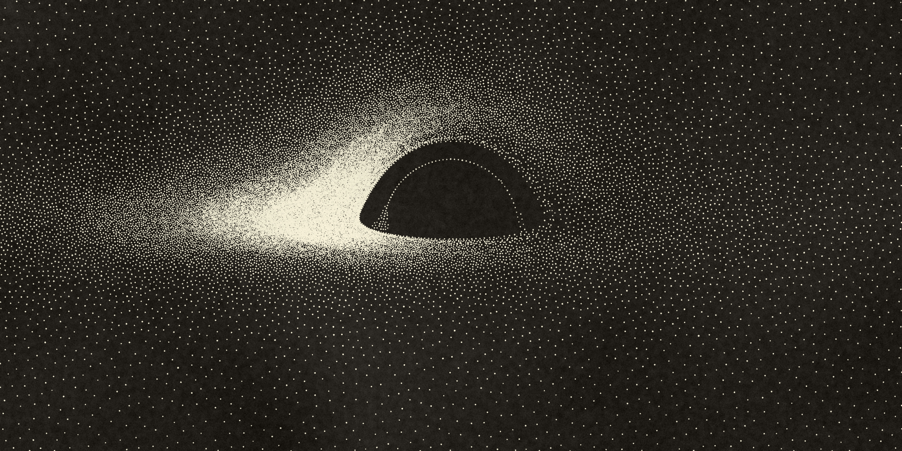
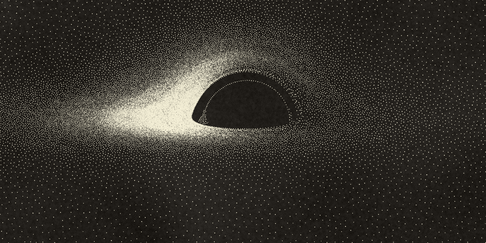
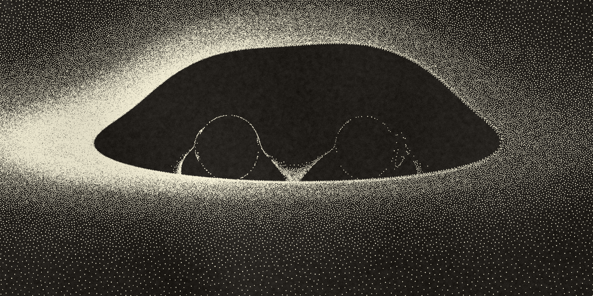

# Recreating Luminet's 1979 black hole image

In 1979, Jean-Pierre Luminet published the first computed image of a black hole surrounded by a glowing accretion disk ("Image of a Spherical Black Hole with Thin Accretion Disk", *Astronomy & Astrophysics* 75, 228–235). He computed the light paths on an IBM 7040 at the Paris Observatory, then drew the final image by hand, dot by dot, in India ink. Forty years later it turned out to look strikingly like the Event Horizon Telescope's real image of M87*.

This project recreates that image. The physics follows the paper; the rendering imitates his hand-inked stippling, tuned against closeups of the original drawing.



## Running it

```bash
pip install numpy scipy matplotlib pillow scikit-image
python luminet_1979.py
```

This writes `luminet_recreation.png` (5600 × 2800 px by default) to the current directory. It may take a minute or two.

### Other black holes

The rendering engine is [`blackhole.py`](blackhole.py). Every setting, physical or stylistic, is a field of its `Params` class, and the defaults are exactly Luminet's. `luminet_1979.py` just renders those defaults, so the recreation is always reproducible. To draw something else, change parameters:

```bash
python blackhole.py --list-params                          # every parameter, its default and meaning
python blackhole.py --set inclination=60 --out tilted.png
python blackhole.py --preset face-on
python blackhole.py --set inclination=50 --set approaching_side=right --set r_out=30 --set view=40
python blackhole.py --params my_hole.json                  # a JSON file of parameter values
```

The order is: `--preset` (default `luminet1979`), then `--params`, then each `--set`. Next to the image, `blackhole.py` saves a `.json` file with every value used, so you can pass it back with `--params` to reproduce the image.

- **Black hole and disk:** spin (`spin`, −0.998 to 0.998; see below), viewing angle (`inclination`, 0° face-on to 90° edge-on), disk inner and outer edge (`r_in`, which defaults to the innermost stable orbit for the spin, and `r_out`), which side rotates toward you (`approaching_side`), the sharp inner edge, and Luminet's approximate ghost ring (`luminet_ghost`).
- **Frame:** zoom (`view`, the half-width in units of M) and shape (`aspect`). The black hole's mass only sets the length unit, so it isn't a parameter.
- **Style:** dot density and contrast, isoradial banding, the hand-drawn inner ring, dot size and shape, colors, and paper texture.
- **Presets:** `luminet1979`, `face-on`, `edge-on`, `truncated-disk` (r_in = 14M), `luminet-ghost`, `spinning` (spin 0.9), `retrograde` (spin −0.9) and `max-spin-edge-on` (spin 0.998 at 87°).
- **Exposure:** the brightest point sets full dot density, as Luminet did. If that would leave less of the disk at full density than his drawing has, the image is brightened until it matches (`auto_exposure`); it is never darkened. This matters most for fast prograde spin, where a tiny region near the hole outshines the rest of the disk by up to ~100 times.
- **Physics limits:** the disk is thin and on circular orbits, and glows by the Page–Thorne (Novikov–Thorne) formula. The observer is far away.

#### Spin

With `spin` at 0, light bending uses the same Schwarzschild code that recreates Luminet's image. With any other spin, every pixel's light ray is traced back through the Kerr geometry of a spinning hole. A ray's radial and polar motions separate when written in Mino time. They're integrated as two smooth equations, one in 1/r and one in cos θ, and the tracer records where each ray first and second crosses the disk plane. These crossings give the direct and secondary images, as before. The rays are split across several processes, so a frame takes about 30 seconds. The spin also changes the disk itself:

- **Innermost stable orbit:** the disk's inner edge moves in to 1.24M at spin 0.998, or out to 9M when the hole spins against the disk.
- **Brightness:** the Page–Thorne formula becomes its Kerr form (Novikov–Thorne).
- **Redshift:** 1+z = u^t (1 − Ω ℓ) for a circular Kerr orbit.

Positive spin turns the same way as the disk, and negative spin turns against it. Checks:

- **Tiny spin:** at spin 10⁻⁶ the Kerr tracer agrees with the Schwarzschild code to about 10⁻⁵ in disk radius and brightness.
- **Shadow shape:** seen edge-on at spin 0.998, the shadow runs from −2.11M to +7.00M, matching the circular photon orbits.
- **Thin vs. wide inner ring:** the inner ring is drawn in Luminet's hand-inked style while it is thin. Near edge-on (88° and beyond) it becomes a broad arc, which is dotted like the rest of the disk (`ring_style`).
- **How lopsided the ring is:** Luminet drew the ring lopsided. The fan is on the bright left only, and the line's dots thin out toward the right. That matches how unevenly the ring's brightness is spread when seen from his 80°. At other angles, the lopsidedness is scaled by the ring's actual brightness asymmetry relative to Luminet's view, squared (`ring_lopsided_power`). Seen face-on the ring is nearly even, so the fan wraps all the way around. At Luminet's own view it is drawn exactly as before.

The animation takes the same options: `python luminet_animation.py --preset edge-on`.

### Animation

```bash
python luminet_animation.py
```

This writes `luminet_animation.mp4`, a 60 fps video of the drawing being inked, at half the still's resolution (2800 × 1400 px). It needs `ffmpeg` on your PATH. At the default of 3 dots per frame, the 24,454 dots take about 2¼ minutes. Run `python luminet_animation.py --help` for all options, such as `--dots-per-frame`, `--dry-seconds` and `--texture`.

- **Drying ink.** Each drop lands wet: about 15% smaller than its final size and domed like a droplet, lit from the upper left with a small glint. Over 5 seconds it flattens and spreads to its final size. When it's dry it is exactly the dot in the still.
- **Lighter paper texture.** The video uses the paper grain and tone variation at half the still's strength (`--texture 0.5`). Use `--texture 1` to match the still.
- **Drawing order.** Dots go down from the inside out, along a short pen path. The drawing is split into thin bands, each about two dot spacings wide. Near the hole the bands are circles; farther out they stretch to the frame's 2:1 shape. The pen sweeps around each band, alternating direction, so every band starts where the previous one ended. A traveling-salesman improvement step (2-opt) then shortens the route. The typical hop between consecutive dots is 0.15 M, close to the 0.12 M spacing between neighboring dots.
- **Same image as the still.** Each frame is built the same way as the still: same dots, same blur, same paper texture. With `--texture 1`, the last frame matches a half-resolution render of the still.
- **Video compression.** Thousands of tiny dots on grainy paper are hard for a video encoder. Three settings deal with that. First, the paper texture stays fixed from frame to frame, so each frame differs from the last only around the drops that are still drying, which keeps the video small. Second, the H.264 encoder runs at high quality (CRF 12) with `-tune grain`, so it doesn't smooth away the grain or the dot edges. Third, the file uses an explicit, tagged BT.709 color conversion, so players don't shift the colors. Use `--lossless` for an exact RGB master (`.mkv`) to re-encode from, or `--pix-fmt yuv444p` for full color resolution.

### Fly-by

```bash
python flyby.py --set spin=0.998
```

This writes `flyby.mp4`: a 24-second, 60 fps video in which the camera flies past the black hole. It takes the same black hole options as the stills (`--preset`, `--set`, `--params`), and runs at about 5 seconds per frame, so the full video takes around 2 hours.

- **The orbit.** The camera falls in from 80M on a real parabolic orbit (energy exactly 1) whose plane is tilted 45° to the disk. Its closest approach is 10M, where it is also highest above the disk. It passes through the disk plane twice, at about 16M, briefly seeing the disk exactly edge-on. Options: `--periapsis`, `--orbit-tilt`, `--retrograde-orbit`, `--start-radius`.
- **What the camera sees.** Each frame is ray traced from the camera's actual position and velocity. That includes light bending and the spinning hole's geometry, plus aberration and Doppler shift from the camera's own motion, up to 0.43c at closest approach. The camera always points at the hole, with a 60° field of view (`--fov`).
- **Pacing.** In the camera's own time, the close encounter is brief. Each frame advances the camera's clock in proportion to its distance (`--pacing 1`), so the encounter fills about 9 of the 24 seconds. `--pacing 0` runs the clock evenly.
- **Dots that stay on the disk.** Each ink dot is a point on the disk that orbits with the gas, so the dots move smoothly as the disk turns and the view changes (`--disk-rotation` speeds this up or slows it down). Each frame, a dot that ends up crowded by an older one fades out, and gaps are filled with new dots that fade in. This keeps the dot spacing following the brightness, as in the stills. About 97% of dots carry over from one frame to the next, even at closest approach. One simplification: the dots ignore the light-travel delays between different parts of the disk. With those delays, near the hole the same parcel of gas can appear twice. The brightness, lensing and redshift keep the full physics.
- **Exposure.** Auto exposure is measured over the whole flight and smoothed over half a second, like a camera's, so the brightness doesn't flicker.
- **Checks.** A motionless camera placed far away reproduces the stills' ray tracer. Over the whole orbit, the camera's 4-velocity stays normalized to 1 within 10⁻⁷.
- **Previews.** `--frames 0.5` saves single frames as PNGs, at fractions of the flight (0.5 is closest approach). `--range 0.45 0.55` renders only part of the flight.

## How it works

### 1. Physics (from the paper)

- **Light bending.** Photon paths around a non-spinning (Schwarzschild) black hole are integrated numerically for a range of impact parameters, using the orbit equation u″ = −u + 3Mu². (Spinning holes use the Kerr tracer described under [Spin](#spin).)
- **Geometry.** The observer sits 10° above the disk plane (80° from its axis), as in the paper's Fig. 11. Each pixel's ray is traced to where it crosses the disk, giving the **direct (primary)** image and the **secondary** image: light that went partway around the hole and forms the thin inner ring.
- **Disk brightness.** The disk runs from the innermost stable orbit (6M) outward and glows according to the Page–Thorne formula (Eq. 15).
- **Redshift.** Observed brightness is the intrinsic brightness divided by (1+z)⁴, where 1+z combines gravitational redshift and the Doppler shift from the disk's rotation (Eq. 19). This makes the approaching (left) side far brighter than the receding (right) side.

**A note on Eq. 15.** The paper prints the coefficient of the log term as √3/3. The correct Page–Thorne value is √3/2, and only √3/2 reproduces the paper's own stated numbers: peak brightness at r ≈ 9.55M and a normalized peak of 1.146×10⁻⁴. The script uses √3/2. With it, the maximum observed brightness comes out at 2.81 versus 2.62 in the paper's Fig. 10, a gap plausibly due to his coarser grid.

### 2. Rendering (imitating the hand-inked drawing)

- **Even dot spacing.** Dots are placed by Poisson-disk sampling: each dot keeps a minimum distance from its neighbors, and that distance shrinks where the disk is brighter. Brightness becomes dot spacing, much as a person inking by hand would build up tone.
- **Clean inner edge.** The first rows of dots along the shadow's edge are placed in regular rows, loosening into random placement a few rows into the disk.
- **Inner ring.** The secondary image is drawn as a carefully spaced dotted line along its inner edge. The spacing doubles from left to right, and the line flares into a fan at the bright lower-left end, with a short two-dot stretch at the lower right.
- **Isoradial banding.** A very faint modulation along curves of constant disk radius echoes how Luminet's data came as isoradial curves.
- **Ink and paper.** Dots are slightly irregular cream blobs on warm dark-gray paper, finished with fine grain, mid-scale mottling and slow tonal drift.

## Faithful vs. tuned

Some choices follow the paper; others were tuned by eye to match the original drawing, because the paper doesn't say how brightness was turned into ink.

| Faithful to the paper | Tuned to match the drawing |
|---|---|
| Viewing angle, disk inner edge, light bending | How brightness maps to dot density (`dot_gamma`, `dot_gain`, `dot_cap`) |
| Page–Thorne brightness (with the √3/2 correction) | Sharp inner disk edge (`sharp_inner_edge`), which departs from strict physics |
| Gravitational + Doppler redshift, (1+z)⁴ dimming | The inner ring's dot spacing and fan shapes |
| Primary and secondary images, opaque disk | Background speckle, banding, paper texture, dot size |

The paper says Luminet estimated the inner ring's brightness with fixed values (r = 9.55M, b = 5.25M) rather than computing it. `--set luminet_ghost=true` (or `--preset luminet-ghost`) uses that approximation; the default draws the fully computed ring.

## Main settings

All settings are fields of `Params` in [`blackhole.py`](blackhole.py); `python blackhole.py --list-params` prints them all. The ones most worth knowing:

| Setting | What it controls |
|---|---|
| `spin`, `inclination`, `r_in`, `r_out`, `approaching_side` | The black hole and disk being drawn |
| `auto_exposure` | Brighten images whose bright region is too small to read |
| `view`, `aspect` | Half-width of the frame (in units of the black hole's mass) and its width:height |
| `dot_spacing` | Dot spacing in the brightest region (smaller = more dots overall) |
| `dot_gamma` | Values above 1 thin the dim right and outer disk |
| `dot_gain` | Pushes mid-bright regions toward full density (the white "claw") |
| `dot_cap` | How packed the brightest, saturated region is |
| `background_density` | Faint speckle in the darkest areas |
| `edge_softness` | How quickly the disk fades in from the shadow edge |
| `edge_rows` | Rows of regular dots along the shadow edge before random placement |
| `ring_style` | The inner ring as Luminet's dotted line and fan, or dotted like the disk |
| `ring_spacing_bright`, `ring_spacing_dim` | Inner-ring dot spacing at each end |
| `fan_max_width`, `fan_taper`, `fan_threshold`, `fan_spacing`, `fan_inside` | Shape and density of the fan on the bright side |
| `ring_second_row` | Length of the two-dot stretch at the dim end |
| `ring_step`, `band_depth` | Spacing and strength of isoradial banding |
| `dot_size`, `ink_blur` | Dot size and edge softness |
| `paper`, `ink` | Colors |
| `texture`, `grain`, `mottle`, `drift`, `edge_roughness` | Paper and photographic texture |
| `seed` | Random seed for dot placement |

The output resolution is a render option, not a parameter: `--res-scale` for `blackhole.py` (1 = 2800 px wide).

## References

- J.-P. Luminet, "Image of a Spherical Black Hole with Thin Accretion Disk", *Astronomy & Astrophysics* 75, 228–235 (1979). [NASA ADS](https://ui.adsabs.harvard.edu/abs/1979A&A....75..228L/abstract)
- D. N. Page and K. S. Thorne, "Disk-Accretion onto a Black Hole. Time-Averaged Structure of Accretion Disk", *Astrophysical Journal* 191, 499 (1974).
- The original image on [Wikimedia Commons](https://commons.wikimedia.org/wiki/File:BH-JPL-A%26A1979.jpg) (CC BY-SA 4.0; credit Jean-Pierre Luminet / CNRS Photothèque).

## License

MIT. See [LICENSE](LICENSE).

### Two black holes merging

```bash
python merger.py
```

This writes `merger.png`: two equal black holes at the moment their horizons touch, inside a thin disk, drawn in the same ink style and from Luminet's viewpoint. It takes about a minute.



- **The spacetime.** No exact solution exists for two orbiting black holes this close, so the holes' fields are added together. Each hole is a non-spinning (Schwarzschild) black hole written in Kerr-Schild form and boosted to its orbital speed, and the two are summed: g = η + H₁ l₁l₁ + H₂ l₂l₂. This is the approach of Combi & Ressler 2024 ([arXiv:2403.13308](https://arxiv.org/abs/2403.13308)). The holes are placed where their horizons touch, 2M apart (M is the total mass), on a circular orbit at the Keplerian rate. Each moves at 0.35c. The separation is held fixed, so the inspiral during the ~10M a ray spends near the holes is ignored.
- **The light.** Every pixel's ray is traced back from a camera 1000M away by integrating the full geodesic equations, so the holes keep moving while the light passes them. The metric is unchanged by a time shift combined with a rotation (a helical symmetry). So p_t + Ω p_φ is conserved along every ray, which takes the place of integrating p_t.
- **The disk.** It's a thin disk around both holes, in their orbital plane, turning the same way they orbit. It runs from 6M (the innermost stable orbit for the total mass) outward, with the same Page–Thorne brightness and sharp inner edge as the 1979 image. The redshift comes from each ray's own momentum and the gas's 4-velocity: 1+z = (p·u)_gas / (p·u)_camera.
- **What it shows.** At this separation the two holes have a single shared shadow, not two dents. Shadows merge long before the horizons do. The shared shadow is about 12.6M wide and 11.9M tall, against 10.4M for a single hole of mass M. It is lopsided like a spinning hole's, from −5.7M to +6.9M across, because the orbital angular momentum acts like a spin of about 0.35. In the drawing, compared with the 1979 one, the dark region is larger and the gap between the direct and secondary images on the bright side is wider. Moving the holes apart (`--set separation=8`) splits the shadow in two. Seen end-on (`--set phase=90`), the front hole bends the back one's shadow into a ring.
- **Pulled apart.** `python merger.py --preset separated --out binary.png` puts the holes 12M apart. Each orbits at 0.14c, and the remaining inspiral takes about 1600M, so holding the separation fixed is a good approximation here. The disk is cleared out to 18M (1.5 times the separation), as a binary's tides clear the middle of a disk around it. Each hole now casts its own shadow against the light it bends from the far side of the disk, with a lensed ring around it. The ring is brighter around the left hole, which is moving toward the camera. Between the two holes, light bent by both is pinched into a bright cusp. The disk's inner edge must stay outside the holes' orbits, and `merger.py` refuses one that doesn't.



- **Where the sum breaks down.** Close to the point where the horizons touch, within about 1.1M, the summed metric stops being a valid spacetime: its determinant changes sign. That region is deep inside the shared shadow, and rays that reach it are counted as falling in.
- **Spin.** Each hole can spin (`spin1`, `spin2`, from −0.99 to 0.99; positive turns with the orbit). Each is then a Kerr black hole in Kerr-Schild form, boosted the same way. A spin can also be tilted away from the orbital axis (`tilt1`, `tilt2`, in degrees) and pointed in the orbital plane (`spin_az1`, `spin_az2`, measured like `phase`: 0 = screen right, 90 = toward the camera). Tilted spins break the helical symmetry, so each ray's p_t is integrated too, from how fast the metric changes in time. Tilted spins also precess: the spins and the orbital plane turn about the total angular momentum J, following the orbit-averaged spin-orbit (1.5 post-Newtonian) equations at fixed separation. The disk then lies perpendicular to J, and the orbital plane wobbles about it. For two equal holes 5M apart, both spinning at 0.9 in the orbital plane, the orbital plane sits 39° off the disk and wobbles around in a few hundred M, against 70M for one orbit. In a 5:1 binary at 3.3M whose big hole spins at 0.9 in the orbital plane, the tilt is 68°. `precess=False` instead freezes the spins and keeps the orbit in the disk plane.
- **Options.** `separation` (0 gives one hole of mass M), `mass_ratio`, the spin options, `phase` (0 = side by side, 90 = the heavier hole in front), `center_x` and `center_y` (pan the frame, in M), plus every option of the stills. List them with `python merger.py --list-params`.
- **Checks.** With `separation=0` the tracer matches the Schwarzschild code above to about 10⁻⁶ in disk radius and redshift. The shadow's size doesn't change when the integration step is halved or the cutoff near the breakdown region is changed tenfold. A single spinning hole matches Bardeen's exact Kerr shadow to 0.002M, with its spin tilted to any viewing angle or turned about the line of sight. With tilted, precessing spins, the null condition g^ab p_a p_b = 0 holds along every ray to 3×10⁻⁵ of the ray's momentum, which checks that p_t is integrated consistently. For aligned spins, integrating p_t gives the same redshifts as the conserved quantity, to 3×10⁻⁵.
